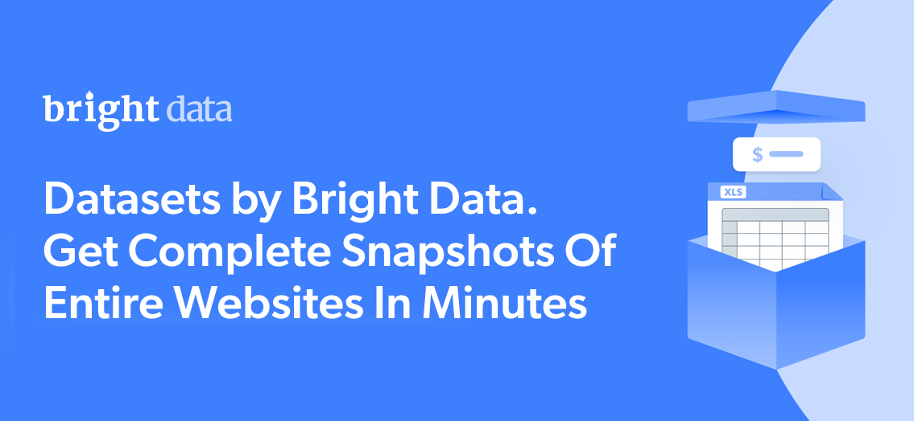

# Target 数据集示例

<h2>1001 个 Target 商品的示例数据集</h2>



一个包含 1000 多个商品的 Target 数据集示例。该数据集使用 <b>Bright Data API</b> 提取。

<h2>此免费数据集包含的数据字段：</h2>

* ```url```：商品的链接或网址
* ```product_id```：商品的唯一标识符
* ```title```：商品标题或名称
* ```product_description```：商品描述
* ```rating```：商品的平均评分
* ```reviews_count```：评分或评论数量
* ```initial_price```：商品初始/原始价格
* ```final_price```：折扣后的最终价格
* ```currency```：定价所用的货币
* ```images```：与商品关联的图片 URL
* ```breadcrumbs```：商品的导航面包屑
* ```seller_name```：卖家名称
* ```find_alternative```：替代商品
* ```product_specifications```：商品规格
* ```shipping_returns_policy```：配送与退货政策
* ```related_categories```：相关品类
* ```amount_of_stars```：星级评分分布
* ```recommendations```：推荐
* ```summary_of_reviews```：评论摘要

以及更多内容。

这是从 “Target Products（公共数据）” 数据集中提取的一个示例子集，完整数据集包含超过 <b>7,100,000 家公司</b>。

可用的数据集文件格式：<b>JSON、NDJSON、JSON Lines、CSV 或 Parquet。可选提供 .gz 压缩</b>。

数据集交付方式选项：<b>电子邮件、API 下载、Webhook、Amazon S3、Google Cloud Storage、Google Cloud Pub/Sub、Microsoft Azure、Snowflake、SFTP</b>。

更新频率：<b>一次性、每日、每周、每月、每季度，或自定义</b>。

可提供基于已提取数据点的数据增强：<b>按需提供</b>。

<b>[获取完整的 Target 数据集](https://www.bright.cn/products/datasets/target)</b>。

<h2>Target 数据集的典型用例是什么？</h2>

<h3>1. 品牌情绪分析</h3>
深入分析商品评论与评分，评估消费者观点，确保产品契合市场期望。利用 Target 数据集理解客户对特定产品或整体品牌的情绪，助力优化商业策略。

<h3>2. 消费需求洞察</h3>
发现库存缺口，识别某些商品的上升需求与消费趋势。Target 数据集帮助企业在库存管理上做出战略决策，优化备货水平，并提升供应链效率。

<h3>3. 竞争性定价策略</h3>
通过识别竞争对手的相似商品与品类来构建稳健的定价策略。利用 Target 数据集确定最优价格，发现价差，并基于实时市场数据实施动态定价模型。

<h2>为学术研究者与公益组织提供免费的爬虫工具与数据集访问</h2>

Bright Initiative 向顶尖高校与研究人员、以及推动各类环保与社会公益事业的 NGO/NPO 提供对 Bright Data 的 <b>[Web Scraper API](https://www.bright.cn/products/web-scraper)</b> 与 <b>[即用型数据集](https://www.bright.cn/products/datasets)</b> 的访问。您可以在<b>[此处](https://brightinitiative.com)</b>提交申请。
