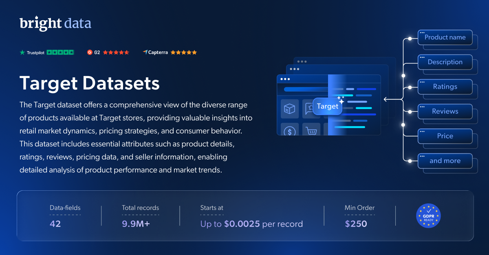

# Target 数据集样本

<h2>包含 1001 件 Target 商品的样本数据集</h2>

<a href="https://www.bright.cn/products/datasets/target">
   
</a>

一个包含 1000 多件商品的 Target 数据集样本。该数据集使用 <b>Bright Data API</b> 提取。

<h2>此免费数据集包含的数据点：</h2>

* ```url```：商品的 URL 或链接
* ```product_id```：商品的唯一标识符
* ```title```：商品的标题或名称
* ```product_description```：商品描述
* ```rating```：商品的平均评分
* ```reviews_count```：商品的评分或评论数量
* ```initial_price```：商品的初始/原始价格
* ```final_price```：商品折扣后的最终价格
* ```currency```：定价所使用的货币
* ```images```：与商品相关的图片 URL
* ```breadcrumbs```：商品的面包屑导航
* ```seller_name```：卖家名称
* ```find_alternative```：替代商品
* ```product_specifications```：商品规格
* ```shipping_returns_policy```：配送和退货政策
* ```related_categories```：相关类别
* ```amount_of_stars```：星级评分分布
* ```recommendations```：推荐内容
* ```summary_of_reviews```：评论摘要

以及更多内容。

这是“Target 商品（公开数据）”数据集的样本子集，该完整数据集包含超过 <b>7,100,000 件商品</b>。

可用的数据集文件格式：<b>JSON、NDJSON、JSON Lines、CSV 或 Parquet。还可选择将文件压缩为 .gz 格式</b>。

数据集交付方式选项：<b>电子邮件、API 下载、Webhook、目标 S3、Google Cloud 存储、Google Cloud PubSub、Microsoft Azure、Snowflake、SFTP</b>。

更新频率：<b>单次、每日、每周、每月、每季度或自定义周期</b>。

除已提取的数据点外，还可提供数据增强服务：<b>根据需求提供。</b>

<b>[获取完整的 Target 数据集](https://www.bright.cn/products/datasets/target)</b>。

<a href="https://www.bright.cn/products/datasets/target">
   
</a>

<h2>Target 数据集有哪些使用场景？</h2>

<h3>1. 品牌情感分析</h3>
深入研究商品评论和评分，以了解消费者意见，并确保你的产品符合市场预期。使用 Target 数据集了解客户对特定商品或整个品牌的看法，从而帮助你优化商业策略。

<h3>2. 消费者需求洞察</h3>
发现库存缺口、识别特定商品不断增长的需求，并洞察消费趋势。Target 数据集可帮助企业制定战略性库存管理决策、优化备货水平并简化供应链，从而提高效率。

<h3>3. 竞争性定价策略</h3>
通过识别竞争对手产品组合中的类似商品和类别，制定稳健的定价策略。利用 Target 数据集确定最优价格、发现定价缺口，并根据实时市场数据实施动态定价模型。

<h2>面向学术研究人员和 NGO 免费开放网页爬虫工具及数据集</h2>

Bright Initiative 为顶尖高校院系和研究人员，以及致力于推动各类环境与社会公益事业的 NGO 和 NPO，提供 Bright Data 的 <b>[网页爬虫工具 API](https://www.bright.cn/products/web-scraper)</b> 和 <b>[即用型数据集](https://www.bright.cn/products/datasets)</b>。你可以在<b>[此处](https://brightinitiative.com)</b>提交申请。
